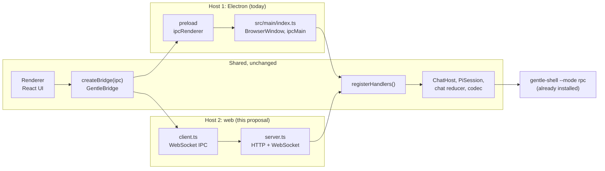
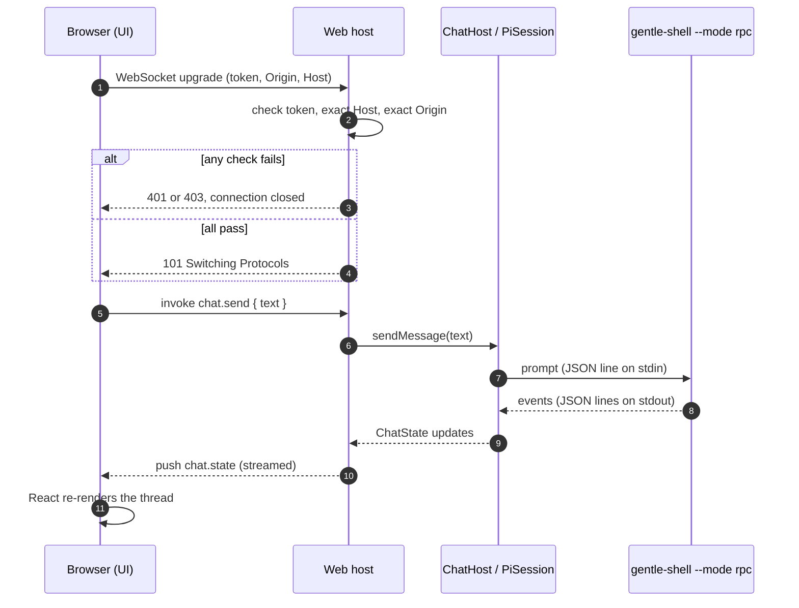
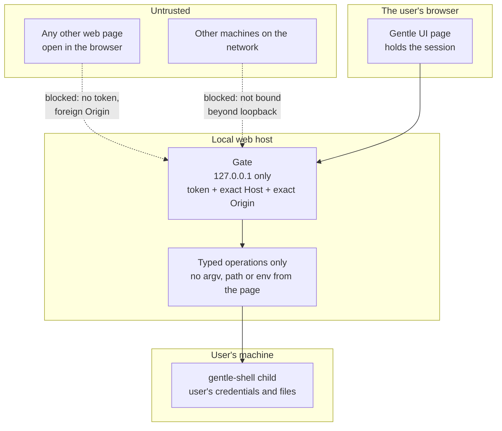
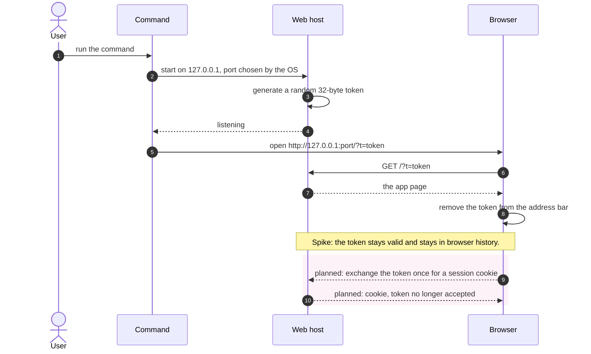
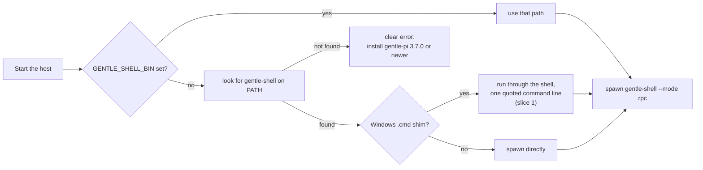
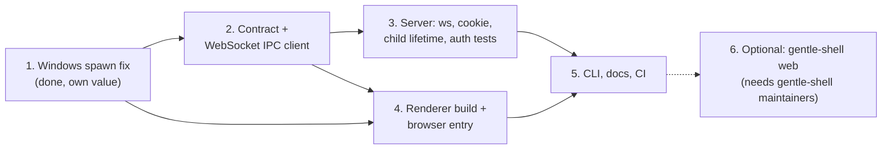
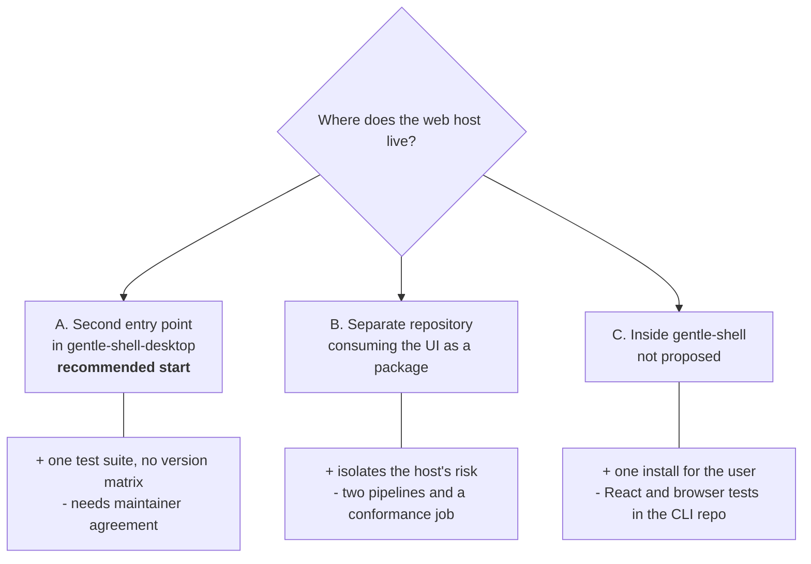

# Web host: diagrams

> Status: proposal. Companion to [README.md](README.md). Mermaid renders on GitHub.
>
> Legend: **solid** = exists today or was observed in the spike. **dashed** = planned, not built or not verified.

## 1. One UI, two hosts

The renderer and the chat domain are shared. Only the layer between them changes.

Only `src/main/index.ts` and `src/main/ipc/registerHandlers.ts` import `electron`. The web host rebuilds the object graph of the first and reuses the second through small stand-ins.

## 2. One message, end to end

What happens when the user sends a prompt. Every arrow past the browser is the same call path the Electron app already uses.

## 3. Trust boundaries

Where untrusted input is, and what each boundary does.

The residual risk is real: a local server in front of an agent with shell access. The gate is the whole defense, which is why it needs its own tests and an independent reviewer (slice 3).

## 4. Starting it

Token handling as the spike does it, and as planned.

## 5. Using an installed gentle-shell

The host does not install or change anything. It finds the launcher the user already has.

Not shown: a version check against the installed `gentle-shell` at startup (audit A8). It is planned for slice 3.

## 6. Slices and what depends on what

Slices 2 and 4 can be worked in parallel once slice 1 is in. Slice 3 is the critical and riskiest one.

## 7. Choices for where the code lives

